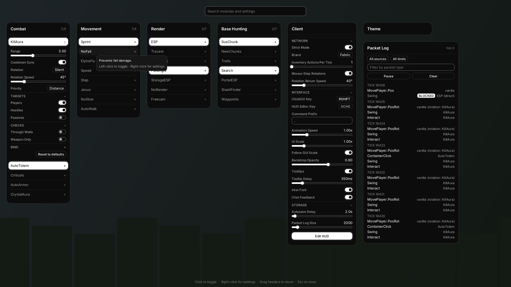
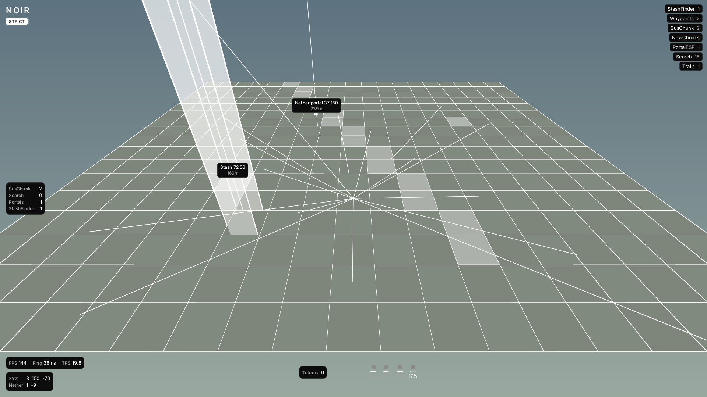

# Noir Client

A Fabric utility client for Minecraft Java **26.2**, built for anarchy servers.
Monochrome "Noir" UI; vanilla-shaped on the wire.



## Status

| Stage | Contents | State |
|---|---|---|
| 1 | Core systems, PacketManager, ClickGUI, HUD, config, commands, packet tests | **Done.** Core compiled and tested; Minecraft layer written, not yet compiled (see below) |
| 2 | Base Hunting: SusChunk, NewChunks, Trails, Search, PortalESP, StashFinder, Waypoints | **Done.** Module logic, scanning, scoring and 3D shapes in the core (105 core tests in total); Minecraft adapters written, not yet compiled |
| 3 | Combat, Movement, Render modules | Not started |

**Build status.** The Minecraft-independent core (`core/`) builds and passes its tests.
The Minecraft layer (`src/main/java`) has **not been compiled yet**: the environment it was
written in could not reach `maven.fabricmc.net` or Mojang's servers. Every Minecraft and
Fabric API call in it was taken from source that targets 26.2 — Fabric API's `26.2`
branch and Meteor Client's last 26.2 commit — rather than from memory, but it still needs
a real `./gradlew build` and an in-game launch before it can be called working.

## Versions

From FabricMC's own 26.2 example mod (`fabric-example-mod`, branch `26.2`) and Fabric API's `26.2` branch:

| | |
|---|---|
| Minecraft | 26.2 |
| Fabric Loader | 0.19.5 |
| Fabric API | 0.161.0+26.2 |
| Loom | 1.18-SNAPSHOT, plugin id `net.fabricmc.fabric-loom` |
| Gradle | 9.7.1 (wrapper included) |
| Java | 25 |
| Mappings | none. Minecraft 26.x ships unobfuscated, so there is no `mappings` line and dependencies use plain `implementation` |

## Build

Requires JDK 25.

```sh
./gradlew build                 # -> build/libs/noir-client-0.1.0.jar (one jar, core included)
./gradlew -p core test          # core unit tests, including the simulated 200-tick packet test
./gradlew -p core renderGuiPreview   # re-renders docs/screenshots from the real GUI code
./gradlew runClient             # dev client
./gradlew runClientGameTest     # in-game packet test (see below)
```

`core/` is a plain Java project with no Minecraft dependency. The root (Loom) project adds
`core/src/main/java` as a source directory, so the shipped jar contains both.

## Install

1. Install Fabric Loader 0.19.5+ for Minecraft 26.2.
2. Put Fabric API 0.161.0+26.2 and `noir-client-<version>.jar` in `.minecraft/mods`.
3. Launch. Config lives in `.minecraft/config/noir/`.

## Default keybinds

| Key | Action |
|---|---|
| Right Shift | ClickGUI (rebind: Client panel → ClickGUI Key, or `.set client clickguikey <key>`) |
| (unbound) | HUD editor (Client panel → HUD Editor Key, `.hud`, or the Edit HUD button) |
| (unbound) | Every module; bind with `.bind` or in the module's Bind section |

Module binds support Toggle and Hold modes, keyboard keys and mouse buttons (`mouse4`, `mouse5`, ...).
Binds don't fire while a screen (chat, inventory, the GUI) is open.

## ClickGUI

- Left-click a module to toggle it; right-click to expand its settings.
- Drag panel headers to move them; right-click a header to collapse it. Positions are saved.
- Type anywhere to search modules and settings.
- Right-click a setting's label to reset it to its default. Each module has a "Reset to defaults" button.
- **Client** panel: Strict mode, brand, UI scale, animation speed, tooltips, autosave and more.
- **Theme** panel: every Noir color, radius and spacing token, plus "Reset to Noir".
- **Packet Log** panel: every outgoing packet per tick and what requested it
  (`vanilla`, `vanilla (rotation: KillAura)`, `AutoTotem`, ...). Filter by source, kind and type; pause; clear.

## HUD

Watermark, ArrayList (sort by length/name/category, fade/slide), coordinates + nether/overworld
coordinates, FPS/ping/TPS, armor durability, totem count, hit counter (SusChunk/Search/...),
Strict-mode indicator and toggle toasts. In the HUD editor: drag to move (elements re-anchor to
the nearest screen region on drop), right-click to toggle, scroll to scale, click for the
element's settings (alignment, offsets, scale and per-element options).

## Base Hunting



*Preview: the real modules over fake chunks, drawn through the same quad-based shape code the game uses.*

All Base Hunting modules are **read-only**: they never request actions and send zero packets
(enforced by the PacketManager and checked by the packet tests). They only read chunk and block
data the server already sent.

**Scanning.** When a chunk arrives, a background thread does one pass over it and caches the
result per chunk: block counts per 16-block section, exposed vs. buried stone and ore, flowing
liquids, block entity totals, and the positions of blocks any enabled module asked for. Rendering
only reads that cache, so scanning never runs on the render thread. A chunk is rescanned when its
blocks change. Scanning only runs while at least one Base Hunting module is enabled. SusChunk's
Clear Cache drops everything and rescans.

### How SusChunk scoring works

Every scanned chunk gets a score. Each check below has its own toggle and weight, and only blocks
between Min Y and Max Y count (block entities count the whole chunk). A chunk scoring at least
**Score Threshold** (default 10) is highlighted, alerted once, and optionally logged and waypointed.
Changing a weight or the threshold rescores from the cache without rescanning.

| Check | Points | Defaults |
|---|---|---|
| Storage | `weight × (storage blocks − allowance)`; chests, trapped chests, barrels, shulkers, ender chests, hoppers, droppers, dispensers | weight 2, allowance 2 |
| Player-placed blocks | `weight × min(count, cap)` for each listed block id: obsidian, beds, shulkers, ender chests, crafting tables, furnaces, anvils, signs, rails, glass, wool, ... (editable list) | weight 1, cap 16 |
| Block entities | `weight × (block entities − allowance)` | weight 0.5, allowance 4 |
| Missing ores | Ore share in stone exposed sideways to air (tunnel and cave walls) vs. buried stone. Strip-mined walls have almost none left. If exposed < factor × buried, up to `10 × weight` | weight 1, factor 0.35, needs 96 exposed stone |
| Portals | `weight × max(1, portal blocks / 6)` | weight 5 |

Display: a flat square at Render Height, or a column over the Y range. It can be colored by score
(Color at the threshold, blending to High Color at 3× the threshold), with the usual
fill/outline/tracer options.

### The other modules

- **NewChunks**: *liquid flow*: flowing-liquid updates arriving within the Detection Window after
  a chunk loads mean it was just generated (new). A chunk that arrives with liquid already settled is
  old. *Version*: overworld chunks with no deepslate/tuff below y 0 (pre-1.18), and nether chunks with
  none of the 1.16 blocks (pre-1.16), are old. Each method can be toggled, with separate colors,
  render height and opacity.
- **Trails**: old chunks grouped into connected paths. A path counts when it's at least Min Trail
  Length long, at most Max Trail Width wide (principal-axis extent), and mostly surrounded by new chunks.
- **Search**: block ESP for a block list with a color per block, max distance, max render count and tracers.
- **PortalESP**: nether portals, end portals and end gateways, one box per portal (connected blocks).
- **StashFinder**: chunks with at least Storage Threshold storage blocks (editable list, Y range).
- **Waypoints**: auto-created by the modules above (Auto Waypoint in each module's Alerts group).
  Name format tokens are `{type} {x} {y} {z} {dim} {n}`. Nearby duplicates are merged. Each
  waypoint gets a beam, plus an on-screen label with its distance. Stored per server in
  `config/noir/waypoints/`.

Alerts are local only: a chat line, a HUD toast, and/or a tab-separated line in
`config/noir/logs/<module>.log` (time, server, dimension, x, y, z, details).

## Commands

Commands use the `.` prefix (configurable). They are handled locally and never sent:
Fabric's `ALLOW_CHAT` event consumes them, and the packet hook also drops any chat packet that
starts with the prefix.

| Command | |
|---|---|
| `.help [command]` | List commands |
| `.toggle <module> [on\|off]` | Toggle a module |
| `.bind <module> <key\|none> [toggle\|hold]` / `.bind list` | Bind a module |
| `.set <module> <setting> [value\|reset]` | Show or change a setting. Also `client`, `theme`, `hud.<element>` |
| `.config save [name]` / `load <name>` / `list` / `delete <name>` / `reset <module\|all>` / `current` | Profiles |
| `.friend add\|remove <name>` / `.friend list\|clear` | Friends (combat modules skip them) |
| `.hud` | Open the HUD editor |
| `.waypoint add <name> <x> <y> <z>` / `remove <name>` / `list` / `clear` | Local waypoints (alias `.wp`) |

Setting names ignore case, spaces and punctuation: `.set killaura attackdelay 4`.
Block/entity lists accept `add <id> [#AARRGGBB]`, `remove <id>`, `clear`, or `id,id,...`.

## Config

`.minecraft/config/noir/`: `client.json` (client settings, theme, active profile), `gui.json`
(panel layout), `friends.json`, `profiles/<name>.json` (modules + HUD). Changes are autosaved
after a short delay (Client → Autosave Delay) and on exit; files are written atomically, and
an unreadable file is kept as `*.corrupt` instead of crashing the client.

## Packet hygiene

All of this is enforced in code, not by convention:

- **One gateway.** Modules have no access to the connection. They ask the `PacketManager`
  (`actions().attack(...)`, `rotate(...)`, `click(...)`, ...). Queued actions run once per tick
  at the end of vanilla's input handling (`Minecraft.handleKeybinds`), in vanilla's order
  (hotbar, inventory, swap, attack, use), through vanilla's own methods
  (`MultiPlayerGameMode.attack` then `LocalPlayer.swing`, `handleContainerInput`, ...).
  That gives vanilla packet shapes, sequence numbers and container state ids.
- **Budgets.** At most one attack, one use and one hotbar change per tick, and one container
  click per tick by default. No attacks while using an item. Reach and line of sight are checked
  unless the module enables through-walls. The attack fires only once the *server-side*
  rotation (sent in an earlier tick's movement packet) actually aims at the target.
- **Movement.** Modules never build movement packets. Silent rotations swap the player's
  rotation around vanilla's `LocalPlayer.sendPosition` and restore it afterwards, so vanilla
  still decides what to send: one packet per tick at most, the 20-tick idle heartbeat, nothing
  when nothing changed. One rotation per tick, pitch clamped to ±90, continuous yaw, deltas in
  multiples of your sensitivity's mouse step, and a smooth return to your real view.
- **Inventory.** Clicks only go to the menu the server has open, and never while a
  client-only screen (chat, the Noir GUI) is open.
- **Read-only modules** (Render, Base Hunting) get an action handle that refuses everything.
  Any packet their code causes is dropped and recorded as a violation.
- **Attribution and guard.** Every outgoing packet passes one hook (`Connection.send`) and is
  attributed to vanilla or to the module whose code was running. A module-caused packet that
  didn't go through the PacketManager is dropped. So are custom payloads and chat from modules.
- **Brand.** "Fabric" (default) leaves Fabric's brand alone. "Vanilla" reports `vanilla` and
  drops every outgoing custom payload except the brand (no channel registration).
  Noir adds no channels, handshakes, telemetry or network calls of its own.

### Strict mode

On by default (Client → Strict Mode, HUD indicator). Settings that would need packets a
vanilla client never sends declare it, and while Strict mode is on those values are greyed out
in the GUI with a tooltip explaining why, refused by `.set`, and replaced by a safe fallback even
if a saved config contains them. Currently blocked:

- **Client → Inventory Actions Per Tick** above 1.

Stage 3 adds Criticals "Packet" mode and NoFall's packet modes to this list.

## Packet tests

- **Simulated (`./gradlew -p core test`, `PacketBudgetTest`).** A headless client reproduces
  vanilla's tick order and `sendPosition` rules. Each module runs for 200 ticks. The test fails
  if any tick exceeds what vanilla could send (1 movement, 1 attack, 2 swings, 1 use,
  1 container click, 1 held-item, 1 player action, 0 custom payloads/chat), if an attack lacks
  its swing, if packets come after the movement packet, if a rotation is out of range or
  duplicated, or if a read-only module sends anything. Adversarial modules (rotation spam with
  NaN and ±200° pitch, 5 clicks per tick, direct connection writes, a Render module trying to
  attack) are checked to be contained.
- **In-game (`./gradlew runClientGameTest`, `PacketBudgetGameTest`).** A Fabric client game
  test in a real singleplayer world. It records 200 idle ticks (only the heartbeat may be sent),
  then enables each registered module alone for 200 ticks with NoAI zombies nearby, and fails on
  any over-budget tick, any packet from a read-only module, or any packet the PacketManager had
  to block.

## Project layout

```
core/src/main/java/dev/noir/          platform-independent, unit-tested
  NoirCore, ClientSettings, Platform
  module/            Module, Category, BindMode, ModuleManager
  module/settings/   Bool/Number/Enum/Color/Keybind/BlockList/EntityList/String settings, groups
  event/             EventBus, events
  network/           PacketManager, RotationManager, PacketLog, PacketAudit, StrictMode, actions
  config/            ConfigManager (profiles, autosave), Friends
  command/           CommandManager and commands
  gui/               Canvas, RasterCanvas, rounded-rect rasterizer, Ui, ClickGui, panels, Theme
  hud/               HudManager, HudEditor, HUD elements
  basehunt/          ChunkScanner, ScanService (off-thread cache), SusScorer, NewChunkTracker,
                     TrailDetector, WaypointStore, FindLog
  render/            WorldCanvas (quads), Shapes (boxes, outlines, tracers, beams), CameraInfo
  module/basehunting SusChunk, NewChunks, Trails, Search, PortalESP, StashFinder, Waypoints
  util/              Colors, Keys, Animation, MathUtil
src/main/java/dev/noir/               Minecraft 26.2 layer
  NoirClient (entrypoint), MinecraftPlatform
  mixin/             Connection, LocalPlayer, Minecraft, KeyboardHandler, MouseHandler, LevelChunk, ClientBrandRetriever
  basehunt/          McChunkView, McChunkSource
  render/            McWorldCanvas (quads -> RenderTypes.debugFilledBox)
  network/           MinecraftPacketSink, PacketClassifier, TpsTracker
  gui/               McCanvas, InterFontAtlas, NoirScreen
  hud/               McHudData, HudEditorScreen
  event/             RenderWorldEvent
  module/            Modules (module registry)
src/gametest/java/dev/noir/gametest/  in-game packet test
```
